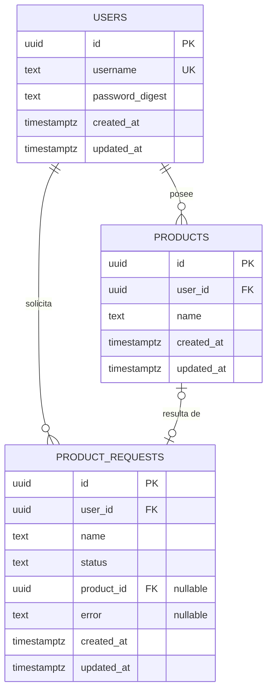

# Modelo de datos

Motor: PostgreSQL 18. Todas las claves primarias son UUID v7 generadas por la base (`uuidv7()`). Los timestamps son `timestamptz`, en UTC. El esquema se crea con las migraciones de `db/migrations/`.

## Diagrama

## Relaciones

| Relación | Cardinalidad | Comentario |
|---|---|---|
| users → products | 1 a N | Cada producto pertenece a exactamente un usuario |
| users → product_requests | 1 a N | Cada solicitud pertenece a quien la creó |
| product_requests → products | 0..1 a 0..1 | Una solicitud `completed` apunta al producto que creó; una `pending` o `failed`, a ninguno |

## Tablas

### users

| Columna | Tipo | Restricciones |
|---|---|---|
| id | uuid | PK, default `uuidv7()` |
| username | text | NOT NULL; se guarda como lo escribió el usuario |
| password_digest | text | NOT NULL (hash bcrypt; la contraseña nunca se guarda) |
| created_at / updated_at | timestamptz | NOT NULL, default `now()` |

Índices: `users_username_lower_index` — `UNIQUE (lower(username))`: `"Nahuel"` y `"nahuel"` son el mismo usuario.

### products

| Columna | Tipo | Restricciones |
|---|---|---|
| id | uuid | PK, default `uuidv7()` |
| user_id | uuid | NOT NULL, FK → users(id) |
| name | text | NOT NULL; sin espacios en los extremos |
| created_at / updated_at | timestamptz | NOT NULL, default `now()` |

Índices: `products_user_id_lower_name_index` — `UNIQUE (user_id, lower(name))`. Garantiza que un usuario no tenga dos productos con el mismo nombre (sin distinguir mayúsculas), incluso ante requests simultáneos. También sirve para filtrar por usuario.

### product_requests

| Columna | Tipo | Restricciones |
|---|---|---|
| id | uuid | PK, default `uuidv7()` |
| user_id | uuid | NOT NULL, FK → users(id) |
| name | text | NOT NULL (ya recortado) |
| status | text | NOT NULL, default `'pending'`; `pending`, `completed` o `failed` |
| product_id | uuid | NULL, FK → products(id), UNIQUE |
| error | text | NULL (`name_taken`, `enqueue_failed`, `creation_failed`) |
| created_at / updated_at | timestamptz | NOT NULL, default `now()` |

Restricciones (CHECK):
- `product_requests_status_check`: `status IN ('pending','completed','failed')`.
- `product_requests_completed_has_product`: `(status = 'completed') = (product_id IS NOT NULL)` — tiene producto si y solo si está completada.
- `product_requests_failed_has_error`: `(status = 'failed') = (error IS NOT NULL)` — tiene motivo si y solo si falló.

Ciclo de vida: `pending` → `completed` o `pending` → `failed`. Los estados finales no cambian.

## Decisiones de diseño

| Decisión | Por qué | Tradeoff |
|---|---|---|
| **UUID v7** como PK | No enumerable (no revela volumen ni permite adivinar ids ajenos); ordenable por tiempo (`ORDER BY id` = orden de creación, base de la paginación); inserciones al final del índice | 16 bytes vs 8 de un `bigint`; menos legible |
| **Generado por la base** (`uuidv7()`, PostgreSQL 18) | Cualquier insert tiene id, incluso fuera de la app | Requiere PostgreSQL 18 |
| **Unicidad por índice sobre `lower(...)`** | La garantía real ante concurrencia la da la base; se conserva el texto original para mostrarlo | Toda búsqueda tiene que usar `lower(...)` |
| **La base garantiza invariantes estructurales** (NOT NULL, unicidad, FK, estados y su consistencia); **los servicios validan valores** (largos, formatos) | Las invariantes no cambian con el negocio; las reglas de valores quedan en un solo lugar | Un bug de validación en un servicio no lo frena la base |
| **`status` como `text` + `CHECK`**, no `ENUM` | Agregar un valor a un `CHECK` es una migración común; a un `ENUM`, una especial | — |
| **`ON DELETE` por defecto** (`RESTRICT`) | No hay borrados en el alcance: nada se borra en cascada por accidente | — |
| **`product_requests` como tabla** y no solo el estado del job en Redis | Redis es la cola (efímera; Sidekiq borra los jobs terminados). El estado de negocio tiene que ser durable, consultable por dueño y servir para la idempotencia del job | Una tabla más |
